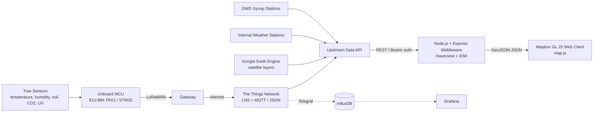

# Smart Trees — Urban Micro-Climate IoT Analysis

[](https://nodejs.org/)
[](https://www.mapbox.com/)
[](https://www.thethingsnetwork.org/)
[](https://earthengine.google.com/)

An open-source Smart City platform that turns urban trees into **living climate indicators**. Environmental sensors mounted on stationary and mobile trees stream measurements over LoRaWAN; a Node.js middleware aggregates these with official weather-station data and satellite imagery, and an interactive WebGL map quantifies the local **microclimate temperature delta** — the cooling or warming effect of each tree relative to a distance-weighted regional baseline.

Developed for the **[Smart Trees](https://smart-trees.de/)** project in cooperation with KielRegion *SmarterLeben*, part of the German federal **[Modellprojekte Smart Cities](https://www.smart-city-dialog.de/en)** programme.

---

## Table of Contents

- [Overview](#overview)
- [Features](#features)
- [System Architecture](#system-architecture)
- [Tech Stack](#tech-stack)
- [Project Structure](#project-structure)
- [Getting Started](#getting-started)
- [API Reference](#api-reference)
- [Methodology](#methodology)
- [Data Sources](#data-sources)
- [Google Earth Engine Scripts](#google-earth-engine-scripts)
- [Future Work](#future-work)
- [Acknowledgments](#acknowledgments)
- [License](#license)

---

## Overview

Urban trees cool their surroundings through shade and transpiration, but this service is rarely measured at a scale that city planners, researchers, and citizens can use. This project combines:

1. **IoT sensor telemetry** from trees (air/soil temperature, humidity, CO₂, UV, soil moisture, conductivity, and more),
2. **Regional weather data** from the German Weather Service (DWD) and an internal station mesh,
3. **Satellite remote sensing** (land surface temperature, soil moisture, land cover, climate zones) via Google Earth Engine.

The map compares the temperature at a tree against a regional baseline built with **Inverse Distance Weighting (IDW)** and renders the result with a divergent red/cyan color scale.


## Features

- **Multi-source data integration** — LoRaWAN tree telemetry, DWD synoptic stations, internal proprietary weather stations, and satellite layers, aggregated through a single middleware.
- **Geospatial modeling** — Haversine great-circle distance and IDW interpolation to construct a local climate baseline.
- **Microclimate delta** — tree sensor temperature minus the interpolated baseline, with sign and color encoding the cooling/warming effect.
- **Interactive WebGL map** — Mapbox GL JS dashboard with custom markers, live popups, layer toggles, and a snapped 10–50 km radius slider.
- **Responsive design** — desktop dashboard plus mobile field layouts.
- **Open standards** — GeoJSON throughout, open-source dependencies, and reproducible Earth Engine scripts.

## System Architecture



## Tech Stack

| Layer | Technologies |
|---|---|
| Edge / connectivity | Onboard ELV-BM-TRX1 (STM32), LoRaWAN, The Things Network |
| Backend middleware | Node.js, Express, node-fetch, cors, dotenv |
| Frontend | Mapbox GL JS, vanilla JavaScript (ES6), CSS |
| Time-series & ops | MQTT, Telegraf, InfluxDB, Grafana |
| Remote sensing | Google Earth Engine (JavaScript API) |
| Geospatial formats | GeoJSON, OpenStreetMap |

## Project Structure

```
smart-trees/
├── backend/
│   └── server.js          # Express middleware: auth, aggregation, Haversine, IDW
├── frontend/
│   ├── index.html         # Layout, sidebar, layer toggles, radius slider
│   ├── map.js             # Mapbox map, markers, popups, delta rendering
│   └── *.svg              # Custom tree / station markers
└── earth-engine/
    ├── climate-zone.js    # Köppen-Geiger (Cfb) for Kiel
    ├── soil-moisture.js   # SMAP enhanced soil moisture
    └── temperature.js     # MODIS land surface temperature
```

## Getting Started

### Prerequisites

- [Node.js](https://nodejs.org/) (v14 or later)
- Access credentials for the upstream data API (base URL, username, password)
- A free [Mapbox access token](https://account.mapbox.com/)
- (For the satellite layer) a [Google Earth Engine](https://earthengine.google.com/) account

### 1. Backend

```bash
cd backend
npm install
```

Create a `.env` file in `backend/`:

```env
FAST_API_URL=https://your-data-api.example.com
FAST_API_USER=your-username
FAST_API_PASSWORD=your-password
```

Start the middleware (runs on port **3000**):

```bash
node server.js
# 🚀 Smart City Server: http://localhost:3000
```

### 2. Frontend

Open `frontend/map.js` and set your Mapbox token:

```js
mapboxgl.accessToken = "YOUR_MAPBOX_PUBLIC_TOKEN";
```

Serve the `frontend/` folder with any static server, for example:

```bash
cd frontend
npx serve .
```

Then open the page in your browser. The client requests the middleware at `http://localhost:3000`.

## API Reference

All endpoints are exposed by the Express middleware.

| Method | Endpoint | Description |
|---|---|---|
| GET | `/api/map-data?radius=<meters>` | Trees, DWD synoptic stations, and internal stations as GeoJSON `FeatureCollection`s |
| GET | `/api/details/:treeId?radius=<meters>` | Tree sensor values plus the IDW regional baseline and metadata |
| GET | `/api/dwd-live/:sourceId` | Latest temperature and humidity for a single DWD station |
| GET | `/api/custom-live/:stationId` | Latest telemetry for an internal proprietary weather station |

### Example response — `/api/details/tree-002`

```json
{
  "name": "Anna",
  "sensor": { "cli_temperature": 21.5, "cli_humidity": 62 },
  "dwd": {
    "temp": 22.3,
    "humidity": 58.4,
    "method": "IDW (20km Radius | 4 Synop Stations)"
  }
}
```

## Methodology

### 1. Haversine distance

The great-circle distance between the tree and each station is computed with the Haversine formula (Earth radius `R = 6371 km`):

```
a = sin²(Δφ/2) + cos(φ₁) · cos(φ₂) · sin²(Δλ/2)
d = R · 2 · atan2(√a, √(1−a))
```

### 2. Inverse Distance Weighting (IDW)

The regional baseline is the weighted average of the latest valid station observation, with weight decaying as the inverse square of distance:

```
wᵢ = 1 / max(dᵢ, 0.1)²
ẑ  = Σ(wᵢ · zᵢ) / Σ(wᵢ)
```

Only observations in the past, within the selected radius, and with non-null values are used. The number of stations is reported in the method label.

### 3. Microclimate delta

```
delta = tree_sensor_temperature − IDW_baseline
```

- `delta < 0` (cyan `#00dbde`) → local **cooling effect**
- `delta > 0` (red `#ff4e50`) → **heat-island** effect

## Data Sources

| Source | Parameters | Role |
|---|---|---|
| LoRaWAN tree sensors | Air/soil temperature, humidity, CO₂, UV, light, pressure, leaf wetness, soil moisture, conductivity, vibration | Tree-level measurements |
| DWD synoptic stations | Standard meteorological variables | Official regional baseline |
| Internal weather stations (`weather-001`, `weather-002`) | Air temperature, humidity | Gap filling near trees |
| Google Earth Engine | LST, soil moisture, land cover, climate zones | City-wide spatial context |
| Global reference sets | World Bank, WHO, GBIF, TRY | Comparison and context |

## Google Earth Engine Scripts

The `earth-engine/` folder contains reproducible scripts clipped to the Kiel boundary (derived from an open German postal-code dataset):

- **Köppen climate zone** — confirms Kiel is a single temperate oceanic class (`Cfb`); exported as GeoJSON/shapefile.
- **SMAP soil moisture** — `NASA/SMAP/SPL3SMP_E`, ~9 km grid, morning/evening passes.
- **MODIS land surface temperature** — `MODIS/061/MOD11A1`, 1 km daily, with scale factor `0.02` and Kelvin→°C conversion.

## Future Work

- **Client-side temperature contours** — render continuous vector surfaces with [Turf.js](https://turfjs.org/) over Mapbox layers.
- **Automated network fallback** — automatically include secondary hourly stations when the primary network is sparse or offline.
- **Token hardening** — restrict the Mapbox token to specific URL origins and scopes.

## Acknowledgments

- [C20 – Institut für transformative Utopie e.V.](https://www.c-20.de)
- KielRegion *SmarterLeben* and the *Modellprojekte Smart Cities* programme (BMWSB)
- The Things Network, Mapbox, Google Earth Engine, OpenStreetMap, and NASA data products

## License

This project is released under the [MIT License](LICENSE).
